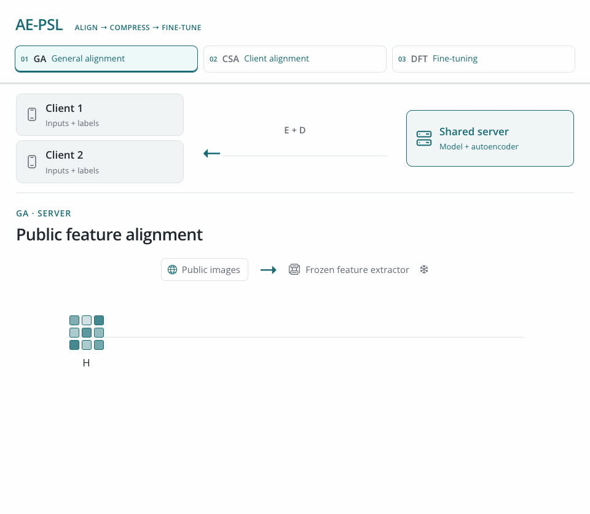

<h1 align="center">AE-PSL</h1>
<p align="center"><strong>AutoEncoder-Compressed Parallel Split Learning<br>for Pre-Trained Model Fine-Tuning</strong></p>
<p align="center">Bas Meuwissen · <a href="https://vtsouval.github.io/"><strong>Vasileios Tsouvalas</strong></a> · Nirvana Meratnia</p>

<p align="center">
  <a href="https://arxiv.org/abs/2607.17913" title="Read the paper"></a>
  <picture></picture>
  <a href="https://nousphera.github.io/AE-PSL/" title="Explore the project"></a>
  <picture></picture>
  <a href="https://nousphera.github.io/assets/posters/ae-psl-a0-landscape.pdf" title="View the poster"></a>
</p>

## Abstract

**AE-PSL** reduces communication in *parallel split learning* with a lightweight autoencoder at the model's split layer. **General alignment** fits the compressor to pretrained features; **client-specific alignment** adapts it to local data while averaging only the decoders. During **downstream fine-tuning**, the compressors stay *frozen*: clients exchange compact activations and gradients with a shared server, while the *CLS token remains uncompressed*. Evaluated across **four vision datasets**, AE-PSL achieves *near-uncompressed accuracy at roughly 10× lower communication* and improves the accuracy–communication trade-off over heuristic compression.

<p align="center">
  <a href="docs/assets/readme/method-light.mp4" title="Watch the method video">
    <picture>
      <source media="(max-width: 600px) and (prefers-color-scheme: dark)" srcset="docs/assets/readme/method-dark-mobile.gif">
      <source media="(max-width: 600px)" srcset="docs/assets/readme/method-light-mobile.gif">
      <source media="(prefers-color-scheme: dark)" srcset="docs/assets/readme/method-dark.gif">
      
    </picture>
  </a>
</p>

## Setup

Create and activate the `ae-psl` environment:

```bash
git clone https://github.com/Nousphera/AE-PSL.git
cd AE-PSL
python3.12 -m venv --prompt ae-psl .venv
source .venv/bin/activate
```

From the activated `ae-psl` environment, install the requirements:

```bash
python -m pip install -r requirements.txt
```

## Data and Weights

Download, prepare and validate the datasets:

```bash
# One dataset
python scripts/prepare_data.py --dataset cifar100

# All paper datasets, including alignment data
python scripts/prepare_data.py
```

**Datasets:** `cifar100` · `food101` · `sun397` · `femnist` · `imagenet100`.

For **ImageNet100**, obtain images from [ImageNet](https://www.image-net.org/download.php) and place 100 matching class folders under `data/raw/imagenet100/train/<class>/` and `data/raw/imagenet100/test/<class>/` before preparation. ImageNet100 supplies the public features for general alignment.

### Prepare Model

Download the pretrained **ImageNet-1K ViT-B/32** weights:

```bash
python scripts/prepare_model.py
```

## Run Experiments

From the repository root, set the shared options and run your chosen method:

```bash
# Shared CIFAR-100 settings
common=(--dataset cifar100 --nr_of_clients 5 --batch_size 125
        --nr_of_epochs 10 --split_layer 5 --dirichlet_alpha 0.5
        --random_seed 42 --device cuda)

# AE-PSL (Ours)
python scripts/run_experiment.py "${common[@]}" --method ae-psl --ae_latent_dim 64

# Uncompressed parallel split learning
python scripts/run_experiment.py "${common[@]}" --method uncompressed

# Rand-Top-K
python scripts/run_experiment.py "${common[@]}" --method rand-top-k --rand_top_k_sparsity 0.065

# ADC
python scripts/run_experiment.py "${common[@]}" --method adc --adc_compression_ratio 0.1

# C3-SL
python scripts/run_experiment.py "${common[@]}" --method c3-sl --c3_sl_compression_ratio 12
```

> [!NOTE]
> AE-PSL uses **30 alignment epochs**, **one client-alignment epoch**, and **rank-16/alpha-32 LoRA**. FEMNIST uses **10% of each writer's samples** with local evaluation; other downstream datasets use global evaluation. Metrics and model checkpoints are saved in `results/`. Communication totals include serialized values, indices and framing.

Paper sweeps: [main results](scripts/studies/main.sh) · [baselines](scripts/studies/baselines.sh) · [alignment](scripts/studies/alignment.sh) · [architectures](scripts/studies/architecture.sh).

## Citation

```bibtex
@inproceedings{meuwissen2026aepsl,
  title={AutoEncoder-Compressed Parallel Split Learning for Pre-Trained Model Fine-Tuning},
  author={Bas Meuwissen and Vasileios Tsouvalas and Nirvana Meratnia},
  booktitle={4th Workshop on Advancements in Federated Learning (WAFL), ECML-PKDD 2026},
  year={2026},
  url={https://arxiv.org/abs/2607.17913}
}
```

[MIT License](LICENSE)
