# AE-PSL

**AutoEncoder-Compressed Parallel Split Learning for Pre-Trained Model Fine-Tuning**

Bas Meuwissen · Vasileios Tsouvalas · Nirvana Meratnia

[ Paper](https://arxiv.org/abs/2607.17913) · [ Project](https://nousphera.github.io/AE_PSL/) · [Citation](CITATION.cff)

## Abstract

Distributed Fine-Tuning (DFT) of large-scale Foundation Models (FMs) on resource-constrained edge devices is limited by local compute constraints and communication overhead. Parallel Split Learning (PSL) reduces client-side computation by keeping few model layers on each client and offloading the remaining computation to the server; however, clients must exchange intermediate activations and gradients with the server at every training step. Existing SL communication-compression methods mainly rely on task-agnostic heuristics, such as sparsification and quantization. While learnable SL compressors can better adapt to intermediate representations, they require co-training with the target model. Therefore, directly inserting them into off-the-shelf FMs introduces feature-distribution misalignment and degrades DFT performance. To address this, we propose AE-PSL, a communication-efficient PSL framework that compresses intermediate activations and gradients using a lightweight AutoEncoder (AE) placed at the split layer. To ensure compatibility of AE compression with pre-trained FMs, AE-PSL introduces a novel two-stage alignment mechanism, which adapts the AE to the pre-trained model’s feature manifold and client-specific feature distributions before DFT. We evaluate AE-PSL across four vision datasets and various communication reduction settings, showing that it preserves downstream accuracy at 10.2× reduction; at the same communication budget, the strongest evaluated heuristic baseline trails AE-PSL by 5.2 percent point. This demonstrates that AE-PSL offers a stronger accuracy–communication trade-off than heuristic SL compression.


<p align="center">
  <a href="https://nousphera.github.io/AE_PSL/#overview">
    <picture>
      <source media="(prefers-color-scheme: dark)" srcset="docs/assets/readme/overview-dark.svg">
      
    </picture>
  </a>
</p>

*Three stages, with compact activations and gradients during fine-tuning.* [Interactive explanation](https://nousphera.github.io/AE_PSL/#overview).

## Requirements

Use Python 3.12 or 3.13. The tested stack is Python 3.12, PyTorch 2.8 and torchvision 0.23.

```bash
git clone https://github.com/Nousphera/AE_PSL.git
cd AE_PSL
bash scripts/setup_env.sh .venv
source .venv/bin/activate
python -m pytest -q
ae-psl --help
```

`PYTHON=python3.13 bash scripts/setup_env.sh .venv` selects another supported interpreter. The script creates a new environment, installs `requirements.txt` (training, FEMNIST preparation, comparison methods and tests), and checks dependencies. Choose a fresh path if an environment already exists. For CUDA, install the matching PyTorch 2.8/torchvision 0.23 wheels for your hardware in that environment.

## Datasets

The preparation CLI writes decoded images, SHA-256 checksums, class mappings and explicit split membership. The trainers consume these manifests directly. Select the datasets your experiment needs:

```bash
python scripts/prepare_data.py images --dataset cifar100 --download
python scripts/prepare_data.py images --dataset food101 --download
# Supply an already acquired official SUN397 archive; its published URL is currently unavailable.
python scripts/prepare_data.py images --dataset sun397 --archive /path/to/SUN397.tar.gz
# Supply licensed ImageNet images in train/<class>/ and test/<class>/ folders.
python scripts/prepare_data.py images --dataset imagenet100 --source /path/to/imagenet100
# Import LEAF's writer-preserving train/*.json and test/*.json splits.
python scripts/prepare_data.py femnist --source /path/to/leaf/femnist/data
```

[Dataset instructions](docs/DATA.md) cover official acquisition, pinned Hugging Face FEMNIST, folder imports, validation, storage and client partitions. SUN397 uses a seeded 80/20 split. ImageNet100 uses your supplied class folders; the manifest records the exact class and image selection.

## Training

Check the installed training stack without downloading datasets or checkpoints:

```bash
ae-psl-smoke --seed 42 --output results/smoke.json
```

This runs the paper’s full torchvision ViT-B/32 (224×224 input, 12 blocks, width
768, 12 attention heads), split at layer 5, with rank-16/alpha-32 LoRA and the
768→768→64 compressor. Weights are explicitly initialized from scratch. Only
sample and step counts are reduced: two public GA images and three client
training images exercise GA → CSA → DFT. It validates execution, not pretrained
accuracy, and needs memory and checkpoint space for the full architecture.
Existing outputs are preserved; choose another output name to rerun.

After preparing CIFAR-100 and ImageNet100, run a single experiment:

```bash
ae-psl --dataset cifar100 --ae_pretrain_dataset imagenet \
  --torch_data_dir data/datasets --model vit_b_32 --nr_of_clients 5 \
  --batch_size 125 --nr_of_epochs 10 --split_layer 5 --ae_latent_dim 64 \
  --random_seed 42 --save_final_model true --experiment_name cifar100
```

Replace `--dataset cifar100` with `food101` or `sun397` for global evaluation, or `femnist` for personalized writer evaluation. FEMNIST defaults to 10% of each writer's samples; `--femnist_fraction 1` retains all samples. GA defaults to 30 epochs on the supplied ImageNet100 subset, followed by one CSA epoch and 10 DFT epochs. The first run downloads torchvision's pretrained ViT weights. Full experiments require substantial compute and storage.

For the downstream-GA ablation, set `--ae_pretrain_dataset` to the same dataset as `--dataset`; only downstream training examples enter GA optimization. `--val_mode early_saving --val_split 0.1` enables held-out checkpoint selection. The primary campaign command saves per-job metrics and completion state and supports `--resume_from_manifest PATH`. The `run_*.sh` scripts provide larger sweeps.

## Pretrained models

The default backbone is torchvision's
[ViT-B/32 with ImageNet-1K weights](https://pytorch.org/vision/0.23/models/generated/torchvision.models.vit_b_32.html).
GA trains the autoencoder on supplied ImageNet100 features; CSA then adapts it to
clients. These fitted compression modules and LoRA adapters are saved with the
experiment's final model when `--save_final_model true` is set.

## Evaluation

The training command performs evaluation and saves metrics for each epoch and
the final selected checkpoint. **Global evaluation** (CIFAR-100, Food101, SUN397)
aggregates client models and bypasses the autoencoder. **Personalized evaluation**
(FEMNIST) retains each client's encoder and reports a macro average across clients.

For validation-based checkpoint selection, add
`--val_mode early_saving --val_split 0.1` to the training command. Validation uses
training examples only; final test metrics come from the selected checkpoint.
The campaign's per-job JSON records `best_validation_epoch`, `last_completed_epoch`
and completion state. [Checkpoint handling](#checkpoints-and-resume).

## Outputs and configuration

The experiment directory contains the effective configuration, per-stage metrics, completion state and saved model checkpoints. Keep these together when comparing runs or resuming a campaign.

The method, communication accounting and checkpoint behavior are specified below.

## Method and communication

GA fits the AE to features from a frozen ViT. CSA adapts each local encoder and
uniformly averages decoder parameters. DFT freezes both AE halves while retaining
gradients through their inputs. The CLS token and its gradient pass unchanged.
Global evaluation averages client models and bypasses AE compression; personalized
evaluation uses local encoders and the shared decoder, then macro-averages clients.
Reconstruction MSE includes the unchanged CLS token, whose error is zero.

The paper backbone is torchvision ViT-B/32 with `IMAGENET1K_V1` weights. LoRA
adapts the ViT MLP linear layers; attention Q/K/V and
`MultiheadAttention.out_proj` are excluded. Rank/alpha default to 16/32. The
two-layer MLP AE uses LayerNorm, GELU and 0.01 encoder dropout during alignment;
frozen AEs use evaluation mode during DFT. Alternative compressors retain the
paper’s ADC, C3-SL and Rand-Top-K comparisons. Unsupported audio and alternate
vision backbones are not exposed. Pretrained weight errors propagate; the Python
constructor’s explicit `pretrained=False` option runs the same ViT from scratch.

The single-process simulator exchanges serialized float32 latent patches and CLS
tokens with shape/dtype headers. The server returns detached logits; clients send
`(n_client / n_global_batch) × dLoss/dLogits`. One server backward pass produces
latent/CLS gradients for the retained client graphs. This sample-weighted objective
handles unequal batches; paper §4.2 writes a sum of client losses.

DFT counters include logit gradients, scalar loss telemetry and message headers.
Detached backpropagation needs those gradients in addition to the paper’s scalar
loss upload, so these counters differ in scope from scalar-only communication
ratios. CSA records raw decoder bytes separately. GA data movement, network framing,
encryption and model distribution are excluded. `_in_mb` result fields are MiB.
`server_batch_mse` is a shared-memory diagnostic; a distributed implementation must
omit it or count its additional traffic. Labels stay in client loss calculations,
but gradients may reveal them; the simulator supplies no privacy protection.

The standard recipe uses split layer 5, latent dimensions 140/64/24, 30 GA epochs,
one CSA epoch, ten DFT epochs, Adam at `1e-4`, global batch 125, five or 25 clients,
and seeds 42/43/44. `d_z=d` means identity compression. CIFAR-100/Food101 preserve
provider splits. SUN397 uses lexically ordered paths and a seeded 80/20 split,
which is separate from the official SUN partition protocol. ImageNet100 uses the
supplied class folders; FEMNIST preserves writer identity. See [data instructions](docs/DATA.md).

## Checkpoints and resume

Campaigns save the effective configuration, per-job JSON, `.status.json`, a dated
manifest and optional model states. A `completion` record identifies the stage,
requested epochs, last completed epoch and early-stop state. With
`--resume_from_manifest PATH`, incomplete jobs restart from the beginning and may
reuse a compatible GA cache. Results are written atomically; failed jobs return
an unsuccessful campaign exit.

With held-out validation, `.best.pth` stores the best checkpoint and `.latest.pth`
the latest epoch. Final testing reloads the best snapshot; `--save_final_model true`
saves that evaluated state. Personalized checkpoints contain all `client_models`
and `server_model`; global checkpoints contain `client_model` and `server_model`.
These are model states, not optimizer resume states. Test accuracy does not select
checkpoints when validation is disabled (the default).

GA cache schema 4 binds seed, training settings, model hash/split, source root,
manifest hash and FEMNIST partition identity. Keep prepared data immutable and
validate hashes after copying it. For unprepared folders, use a fresh cache after
changing files. Match explicitly selected `--ae_specific_weights_path` checkpoints
to the experiment configuration.

Tests exercise the complete paper architecture, serialized gradient equivalence,
frozen backbone/AE behavior, unchanged CLS gradients, local adaptation, global
and personalized evaluation, dataset/cache integrity, checkpoint selection and
campaign resume. Full corpus runs and pretrained accuracy remain separate research
experiments. Install the project dependencies with `python -m pip install -r requirements.txt`.

## Results

**Published global evaluation:** ViT-B/32, split layer 5, five clients and
Dirichlet concentration 0.5. Accuracy is mean ± standard deviation over three
seeds. Compressed methods use approximately 10× communication reduction;
the uncompressed reference uses 1×. The autoencoder is bypassed at evaluation.

| Method | CIFAR-100 (%) | Food101 (%) | SUN397 (%) |
| --- | --- | --- | --- |
| No compression · R=1 | 82.7 ± 0.2 | 69.1 ± 0.9 | 67.0 ± 0.6 |
| C3-SL | 50.9 ± 1.2 | 40.3 ± 1.2 | 41.3 ± 2.1 |
| Rand-Top-K | 76.2 ± 0.4 | 60.2 ± 0.2 | 62.9 ± 1.0 |
| ADC | 68.4 ± 0.4 | 54.6 ± 1.6 | 52.9 ± 1.1 |
| **AE-PSL** | 82.7 ± 0.2 | 69.6 ± 1.2 | 66.7 ± 0.3 |

Source: [Table 4](https://arxiv.org/pdf/2607.17913v1#page=17).
[More compression settings and personalized evaluation](https://nousphera.github.io/AE_PSL/#findings).

## Citation and license

Use [CITATION.cff](CITATION.cff) for the paper citation and [LICENSE](LICENSE) for
the project’s MIT terms. Dataset partitioning components adapted from
[Flower](https://github.com/adap/flower), LoRA components and comparison methods
retain their inline source references. Third-party code, models and datasets
retain their respective licenses and access terms.
